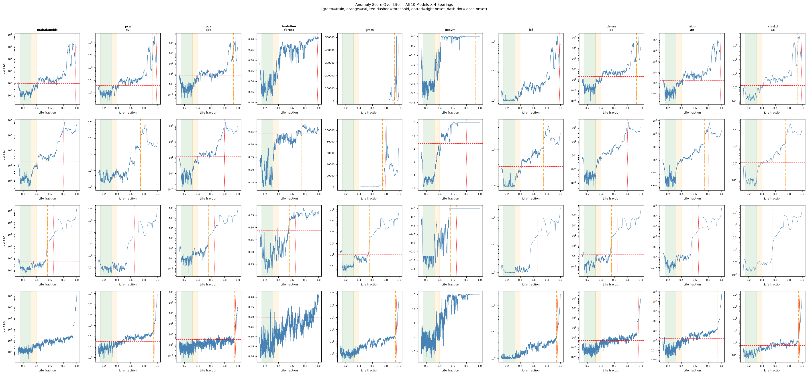
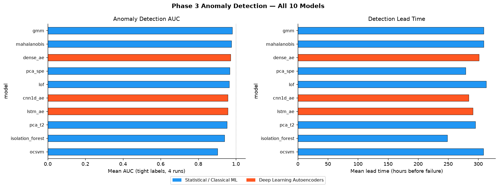
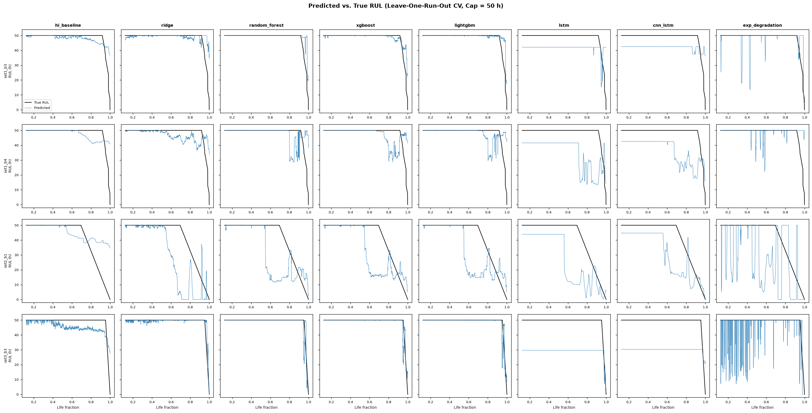
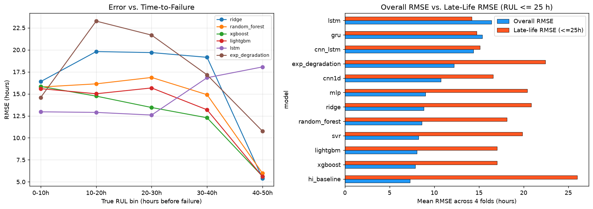

# Anomaly Detection & RUL Prediction on the NASA (IMS) Bearing Dataset

An end-to-end Prognostics and Health Management (PHM) pipeline for bearing **Anomaly Detection** (10 models across 3 families) and **Remaining Useful Life (RUL) Prediction** (12 models across 4 families) evaluated with rigorous temporal & Leave-One-Run-Out (LORO) validation.

---

## 1. Dataset & Experimental Design

The NASA/IMS bearing dataset contains three run-to-failure vibration experiments sampled at **20 kHz** (20,480 samples per 1-second snapshot, ~10-minute intervals):

| Experiment | Channels | Known Failures | Burn-in / Gaps |
|---|---|---|---|
| **Set 1** | 8 (2 per bearing) | Bearing 3 (inner race), Bearing 4 (roller element) | 24 gaps > 15 min (486 h); RMS step-up at idx 156 (`burn_in=0.12`) |
| **Set 2** | 4 (1 per bearing) | Bearing 1 (outer race) | No gaps |
| **Set 3** | 4 (1 per bearing) | Bearing 3 (outer race) | 4 gaps (21 h) |

This yields **4 run-to-failure trajectories** (`set1_b3`, `set1_b4`, `set2_b1`, `set3_b3`) plus **8 healthy control bearings** (`set1_b1`, `set1_b2`, `set2_b2`, `set2_b3`, `set2_b4`, `set3_b1`, `set3_b2`, `set3_b4`) used to measure false alarms.

### Pipeline Overview
```text
Raw 20 kHz Signals ─▶ Feature Extraction (Time + FFT + Hilbert Envelope)
  ─▶ Health Indicator (Smoothed RMS, MAD z-score)
  ─▶ Label Construction (Onset rule + 50 h piecewise-linear RUL cap)
  ─▶ Anomaly Detection (10 models, train/cal/test + control-bearing margin)
  ─▶ RUL Prediction (12 models, 4-fold Leave-One-Run-Out CV)
  ─▶ Evaluation & Ablations
```

---

## 2. Feature Engineering & Label Construction

- **Time domain (9):** `rms`, `peak`, `p2p`, `std`, `kurt`, `skew`, `crest`, `shape`, `impulse`.
- **Frequency & Envelope domain (16+):** 8 FFT band energy fractions (`band0_frac`–`band6_frac` used in modeling; `band7_frac` dropped to avoid collinearity), `spec_entropy`, `spec_centroid`, plus Hilbert-envelope (2–9 kHz bandpass) fault-band SNRs around **BPFO, BPFI, BSF, FTF**, and shaft harmonics (`SPEED_SCALE = 0.979` calibrated from observed vs. nominal Set 2 BPFO).
- **Anomaly Onset Labels (evaluation only):** Smoothed RMS (`win=15` causal median) / baseline (`life ∈ [0.15, 0.40)`) exceeding `1.25` (tight) or `1.10` (loose) for 20 consecutive snapshots (`life ≥ 0.40`).
- **Piecewise-Linear RUL Labels:** Capped at **`RUL_CAP = 50 h`** (matching the `48.75 h` median onset-to-end duration across the 4 runs), declining linearly to `0 h` at failure.

---

## 3. Anomaly Detection Results (10 Models)

All models are fit **strictly on healthy data** (`life ∈ [0.15, 0.32)`), calibrated on `[0.32, 0.40)` at the **99.5th percentile**, and require **10 consecutive exceedances** to confirm an alarm.

### Failed Bearings (Mean across 4 runs)

| Model | Family | Mean AUC (tight) | Mean Alarm Life | Mean Lead Time (h) | Pre-Onset Alarm Rate |
|---|---|---:|---:|---:|---:|
| `gmm` | Statistical | **0.981** | 0.453 | 309.3 | 0.670 |
| `mahalanobis` | Statistical | 0.976 | 0.454 | 309.0 | 0.737 |
| `dense_ae` | Deep Learning AE | 0.970 | 0.461 | 301.8 | 0.691 |
| `pca_spe` | Statistical | 0.967 | 0.483 | 278.9 | 0.531 |
| `lof` | Classical ML | 0.965 | **0.451** | **313.1** | 0.726 |
| `cnn1d_ae` | Deep Learning AE | 0.957 | 0.477 | 284.4 | 0.683 |
| `lstm_ae` | Deep Learning AE | 0.956 | 0.473 | 290.9 | 0.693 |
| `pca_t2` | Statistical | 0.953 | 0.492 | 295.4 | 0.610 |
| `isolation_forest` | Classical ML | 0.940 | 0.550 | 248.6 | **0.337** |
| `ocsvm` | Classical ML | 0.902 | 0.455 | 308.5 | 0.734 |

### Control-Bearing Margin (Blocked-CV Threshold on `0.15–0.40`)
`Margin = earliest healthy control-bearing alarm in the same rig − failed-bearing alarm` (positive = failing bearing flagged earlier than healthy ones):
- **Best Margin:** **`lstm_ae` (`+0.120`)**, followed by `pca_t2` (`+0.100`), `isolation_forest` (`+0.062`), `ocsvm` (`+0.061`), and `gmm` (`+0.044`), whereas `pca_spe` (`-0.127`) is misled by rig-wide drift on control bearings.
- **Takeaway:** While **`gmm`** and **`mahalanobis`** achieve the highest raw AUC on failing bearings, **`lstm_ae`** best separates true bearing degradation from rig-wide drift on healthy control bearings.




---

## 4. RUL Prediction Results (12 Models, 4-Fold LORO CV)

Models are evaluated using **Leave-One-Run-Out cross-validation** (train on 3 bearings, test on the 4th, rotating across all 4). Scalers are fit strictly on training runs; sequence windows (`W=20`) are built strictly within each run.

| Model | Family | Overall RMSE (h) | Overall MAE (h) | Mean PHM Score | Late-Life RMSE (`≤25h`) |
|---|---|---:|---:|---:|---:|
| `hi_baseline` | Baseline | **7.30 ± 3.10** | 4.12 ± 2.01 | 1.20 ± 1.12 | 26.00 ± 4.71 |
| `xgboost` | Classical ML | 7.88 ± 5.64 | 3.82 ± 3.99 | 1.06 ± 1.14 | 17.04 ± 12.55 |
| `lightgbm` | Classical ML | 8.05 ± 5.68 | **3.75 ± 4.15** | 1.14 ± 1.21 | 17.01 ± 12.83 |
| `svr` | Classical ML | 8.24 ± 3.46 | 5.03 ± 2.37 | **1.02 ± 0.70** | 19.87 ± 5.80 |
| `random_forest` | Classical ML | 8.62 ± 6.44 | 4.00 ± 4.66 | 1.39 ± 1.57 | 18.13 ± 13.30 |
| `ridge` | Baseline | 8.82 ± 7.48 | 4.83 ± 5.34 | 1.69 ± 2.26 | 20.86 ± 9.73 |
| `mlp` | Deep Learning | 9.00 ± 2.82 | 4.97 ± 1.91 | 1.66 ± 1.19 | 20.42 ± 13.45 |
| `cnn1d` | Deep Learning | 10.74 ± 4.51 | 6.27 ± 3.07 | 1.71 ± 0.91 | 16.59 ± 14.26 |
| `exp_degradation` | Degradation Model | 12.22 ± 7.21 | 6.46 ± 6.82 | 2.59 ± 2.74 | 22.43 ± 10.05 |
| `cnn_lstm` | Deep Learning | 14.39 ± 4.34 | 12.64 ± 4.69 | 2.32 ± 0.92 | 15.11 ± 9.36 |
| `gru` | Deep Learning | 15.37 ± 4.57 | 13.51 ± 4.56 | 2.67 ± 1.06 | 14.75 ± 8.27 |
| `lstm` | Deep Learning | 16.42 ± 4.86 | 14.08 ± 4.54 | 3.20 ± 1.28 | **14.19 ± 11.65** |

### Key RUL Findings & Ablations
1. **Overall RMSE vs. Late-Life Accuracy:** `hi_baseline` achieves the lowest overall RMSE (`7.30 h`) only because it hovers near `50 h` throughout the healthy plateau—its late-life RMSE (`RUL ≤ 25 h`) is the worst (`26.00 h`).
2. **Best All-Around RUL Models:** **`xgboost`** (`RMSE 7.88`, `PHM 1.06`), **`lightgbm`** (`MAE 3.75`), and **`svr`** (`PHM 1.02`) deliver the strongest overall balance across folds.
3. **Sequence Models Excel in Late Life:** **`lstm`** (`14.19 h`), **`gru`** (`14.75 h`), and **`cnn_lstm`** (`15.11 h`) achieve the lowest RMSE in the critical `RUL ≤ 25 h` window, though they underpredict the `50 h` healthy plateau on unseen runs.
4. **Smoothing Ablation (`win=15` causal median):** Reduces RMSE on noisier sequence/degradation models (`cnn1d`: `-0.20 h`, `exp_degradation`: `-0.14 h`, `lstm`: `-0.10 h`) while remaining neutral on tree/linear models.
5. **Calendar vs. Operating Hours Ablation:** Operating-hour labels increase LORO RMSE across tested models (e.g., `xgboost` `7.88 → 10.86 h`), because Set 1's 486 h of downtime gaps compress its operating-time curve differently from Sets 2 & 3.




---

## 5. Repository Structure

```text
bearing-rul-project/
├── data/                     # Raw IMS sets + processed_features.parquet & env_spectra.npy
├── notebooks/
│   ├── 01_eda.ipynb          # Signal inspection, fault frequencies, HI selection
│   ├── 02_labels.ipynb       # Sampling gaps, onset rules, calendar vs operating hours
│   ├── 03_anomaly.ipynb      # 10 anomaly detection models + control-bearing evaluation
│   └── 04_rul.ipynb          # 12 RUL models, 4-fold LORO CV, PHM score & ablations
├── results/                  # Saved plots and data_notes.md
├── src/
│   ├── data_loader.py        # Raw snapshot & timestamp loader
│   ├── features.py           # Time, FFT, and Hilbert envelope features
│   ├── build_features.py     # Feature extraction pipeline
│   ├── health.py             # Robust normalization & HI metrics (mono, trend, prog)
│   ├── labels.py             # Onset detection & RUL label generation
│   ├── models_anomaly.py     # 10 anomaly detection models
│   ├── models_rul.py         # 12 RUL prediction models
│   └── evaluate.py           # Blocked CV, LORO CV, RMSE/MAE/PHM metrics
├── requirements.txt
└── README.md
```

## 6. Setup & Execution

```bash
pip install -r requirements.txt
python -m src.build_features   # extracts data/processed_features.parquet & data/env_spectra.npy
```
Then run the notebooks in order: `01_eda.ipynb` → `02_labels.ipynb` → `03_anomaly.ipynb` → `04_rul.ipynb`.
